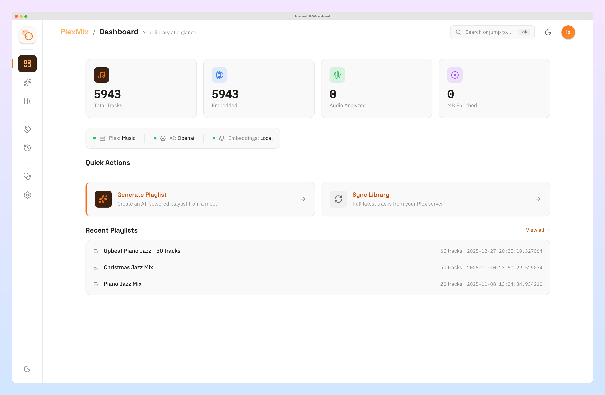
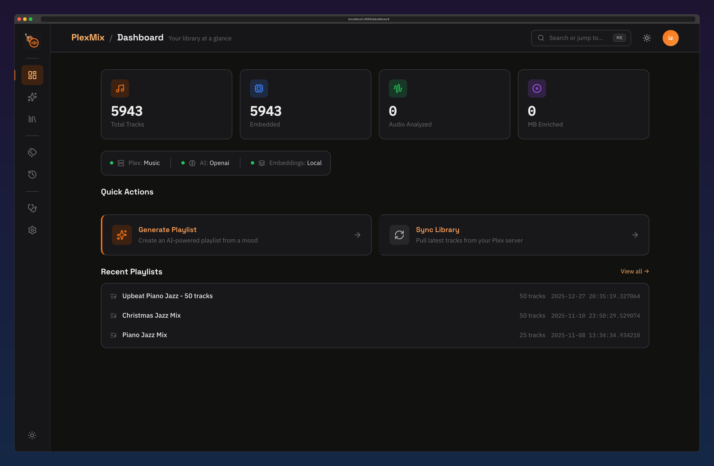
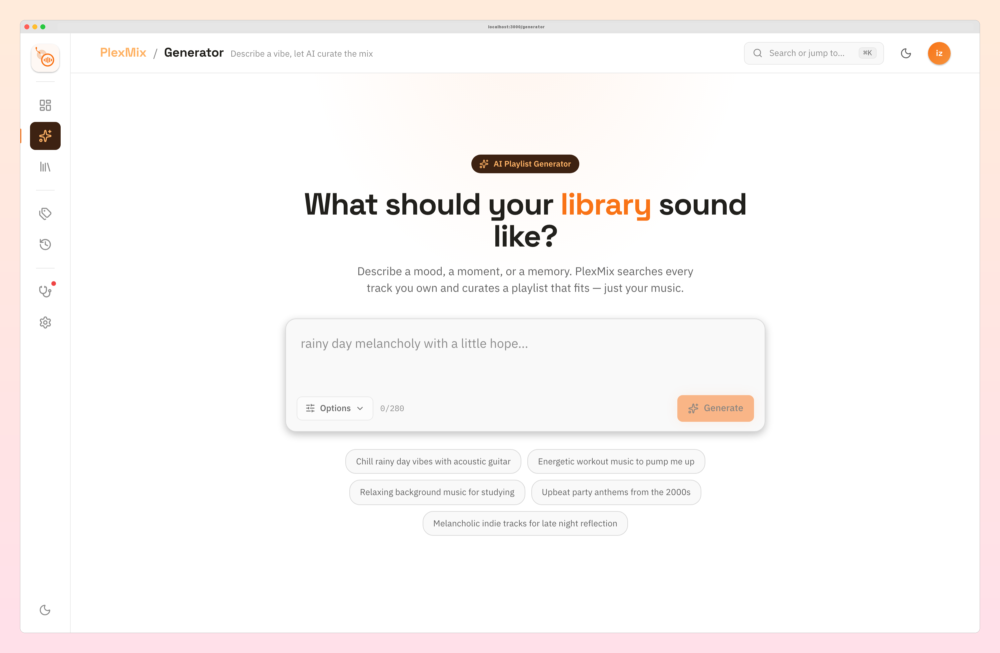
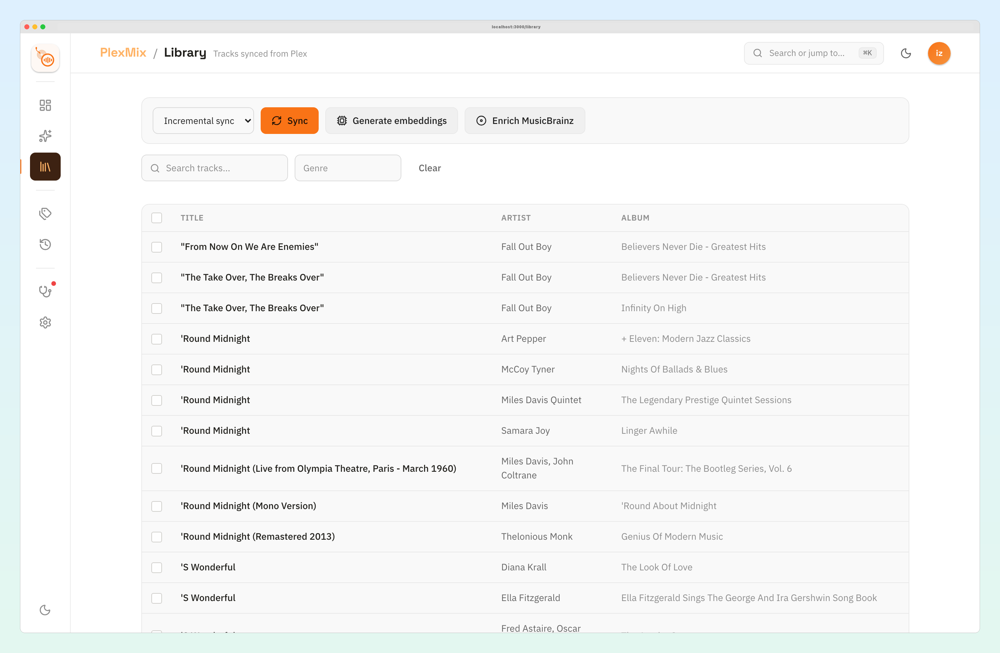
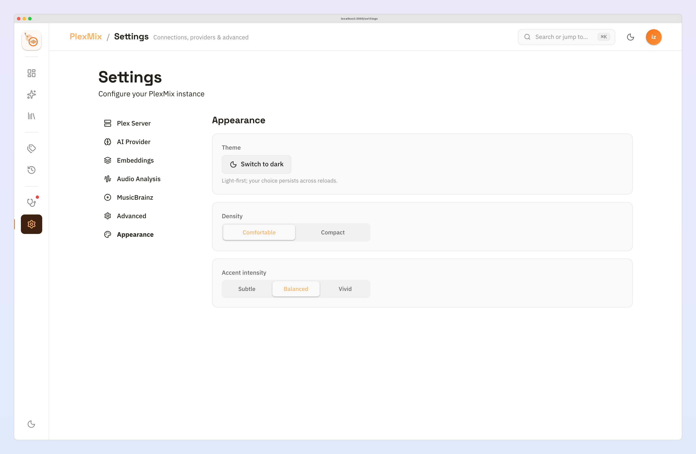

<div align="center">
  

  # PlexMix

  [](https://www.gnu.org/licenses/agpl-3.0)
  [](https://badge.fury.io/py/plexmix)
  [](https://www.python.org/downloads/)

  **AI-powered Plex playlist generator using mood-based queries**
</div>

PlexMix syncs your Plex music library to a local SQLite database, generates semantic embeddings for tracks, and uses AI to create personalized playlists based on mood descriptions.

## Features

- ✨ **Simple Setup** - Only requires a Google API key to get started
- 🎵 **Smart Sync** - Syncs Plex music library with incremental updates and pre-flight token validation
- 🤖 **AI-Powered** - Uses Google Gemini, OpenAI GPT, Anthropic Claude, Cohere Command, or fully local Gemma/Mistral models
- 🔌 **Bring-Your-Own LLM** - Point PlexMix at any OpenAI-compatible local endpoint (Ollama, LM Studio, llama.cpp) with auto-discovery and SSE streaming
- 🏷️ **AI Tagging** - Automatically generates tags, environments, and instruments with stale tag detection and re-tagging
- 🎵 **Audio Analysis** - Extract tempo, key, energy, danceability via Essentia DSP (optional)
- 🎸 **MusicBrainz Enrichment** - Community-curated genres, canonical artist IDs, and recording type detection (optional)
- 🔍 **Semantic Search** - FAISS vector similarity search with incremental index updates
- 🎨 **Mood-Based** - Generate playlists from natural language descriptions
- 🔀 **Smart Ordering** - 4 track ordering modes: similarity, random, alternating artists, and energy curve
- 📋 **Templates** - Save and reuse playlist generation configs with 5 built-in presets
- ⚡ **Fast** - Local database with optimized indexes, full-text search, and versioned migrations
- 🎯 **Flexible** - Filter by genre, year, rating, artist, environment, instrument, tempo, energy, key, and danceability
- 📦 **Export/Import** - Export playlists as JSON or M3U; import from files with track matching
- ⌨️ **Keyboard Shortcuts** - ⌘K or Ctrl+K (or `/`) opens a command palette with your recent prompts and **Generate “…”** for any text you type (↑↓ to move, Enter to run, `Esc` to close), plus Vim-style `g+key` navigation
- 🐳 **Docker Ready** - Deploy with Docker Compose for containerized setups
- 🛡️ **Resilient** - Automatic database recovery if deleted or corrupted

## Quick Start

### Option 1: Command Line Interface (Recommended)

```bash
# Install from PyPI
pip install plexmix

# Run setup wizard
plexmix config init

# Sync your Plex library (incremental, generates embeddings automatically)
plexmix sync

# Generate AI tags for tracks (enhances search quality)
plexmix tags generate

# Create a playlist
plexmix create "upbeat morning energy"

# With filters
plexmix create "chill evening vibes" --genre jazz --year-min 2010 --limit 30

# Filter by environment and instrument
plexmix create "focus music" --environment study --instrument piano

# Filter by audio features (requires audio analysis)
plexmix create "dance party" --tempo-min 120 --energy high --danceable 0.7

# Smart ordering modes
plexmix create "workout mix" --shuffle energy_curve
plexmix create "variety hour" --shuffle alternating_artists

# Avoid tracks from recent playlists
plexmix create "fresh picks" --avoid-recent 5

# Use alternative AI provider
plexmix create "workout motivation" --provider openai

# Retag tracks older than 30 days
plexmix tags generate --retag-stale 30

# Export/import playlists
plexmix playlist list
plexmix playlist export 1 --format json
plexmix playlist import my_playlist.json

# If you encounter issues (e.g., "0 candidate tracks")
plexmix doctor

# Regenerate all tags and embeddings from scratch (WARNING: destructive)
plexmix sync regenerate
```

### Option 2: Docker

Pre-built multi-platform images (amd64 + arm64) are published to GHCR on every release in two variants:

| Image Tag | Size | Use Case |
|-----------|------|----------|
| `ghcr.io/izzoa/plexmix:latest` | ~470MB | Cloud AI providers + audio analysis (Gemini, OpenAI, Claude, Cohere) |
| `ghcr.io/izzoa/plexmix:latest-local` | ~4GB+ | Everything above + local embeddings and local LLM (includes PyTorch) |

```bash
# Pull the slim image (recommended for most users)
docker pull ghcr.io/izzoa/plexmix:latest

# Or pull the local/offline image (includes sentence-transformers + PyTorch)
docker pull ghcr.io/izzoa/plexmix:latest-local

# Run with Docker Compose (clone the repo for docker-compose.yml)
git clone https://github.com/izzoa/plexmix.git
cd plexmix
cp .env.example .env
# Edit .env with your PLEX_TOKEN, GOOGLE_API_KEY, etc.
docker compose up -d

# Access the web UI at http://localhost:3000
# (the container builds the web UI when it starts; the first start can take a few minutes)

# Run CLI commands via Docker
docker compose run plexmix sync
docker compose run plexmix create "chill evening vibes"
```

### Option 3: Web User Interface (Alpha)

> **Note:** The Web UI is currently in Alpha status. The CLI is the recommended way to interact with PlexMix for production use.

```bash
# Install with UI extras
pip install "plexmix[ui]"

# Or if using poetry
poetry install -E ui

# Launch the web UI (builds and serves the optimized production build)
plexmix ui

# Optional: listen on all interfaces and set the frontend/backend ports (defaults shown)
plexmix ui --host 0.0.0.0 --port 3000 --backend-port 8000

# Working on PlexMix itself? Use the hot-reloading development server
plexmix ui --dev
```

Then open your browser to `http://localhost:3000`

**Production build by default:** `plexmix ui` builds the web UI before serving it, so the page is not reachable right away. The first start can take a few minutes while the frontend is installed and built; the CLI prints "Building the web UI (first start can take a few minutes)…" while it works. `--prod` is still accepted and is the default. Pass `--dev` only when you are changing PlexMix's code: it enables hot reload, but pages load far more slowly.

- **pip installs:** Reflex writes its build and session files (`.web/`, `.states/`) next to the installed package, so install PlexMix into a virtualenv you own. If that directory is not writable, `plexmix ui` exits with an explanation instead of starting.
- **One backend worker:** job progress, cancellation and sign-in sessions are kept in the server's memory, so the UI always runs a single backend worker. Redis is not supported: if `REFLEX_REDIS_URL` or `REDIS_URL` is set, `plexmix ui` warns and ignores it.

**Password Protection:** Set `PLEXMIX_UI_PASSWORD` to require a password before accessing the UI. This is recommended when binding to `0.0.0.0` or exposing the UI on a network.

```bash
PLEXMIX_UI_PASSWORD=mysecret plexmix ui --host 0.0.0.0
```

- **One sign-in per browser:** after you sign in, other tabs and windows of the same browser are let in too, for up to 7 days. The session is a signed cookie (`plexmix_session`); a browser that blocks cookies asks for the password again after every reload. The server also keeps a copy in its session files (`.states/`), which `plexmix ui` makes readable only by your user account.
- **Ending sessions:** **Log out** ends the session in that browser: tabs opened or reloaded afterwards ask for the password. Other tabs that were already open stay signed in until they are reloaded (switching pages inside an open tab keeps the sign-in that tab already has), so on a shared computer close or reload them too. Changing `PLEXMIX_UI_PASSWORD` ends every session in every browser. To sign out every browser without changing the password, delete `ui_session.key` from the data directory (`~/.plexmix/ui_session.key`, or `/data/ui_session.key` in Docker); PlexMix creates a new key automatically.
- **Beyond your LAN:** the UI is served over plain HTTP and the session cookie is not marked `Secure`. If you expose PlexMix outside your local network, put it behind a reverse proxy that terminates HTTPS.

#### Screenshots

<div align="center">

 

*Dashboard — glass icon rail, ⌘K command palette, and a working light/dark theme*



*The Generator showpiece — describe a vibe and an animated AI-thinking pipeline curates a playlist from your own library*



*Library — search, filter, sync, and bulk-manage thousands of tracks*



*Settings — connections, providers, embeddings, and the new Appearance controls (theme, density, accent)*

</div>

#### Web UI Features

The web interface is built around a slim glass **icon rail** and a **command palette** (⌘K on macOS, Ctrl+K elsewhere):

- **📊 Dashboard** - A [setup checklist](#setup-checklist) on new installs, the track count and when the library last synced ("5,943 tracks · synced 2 h ago"; hover for the exact time), [status lights](#status-lights) for Plex, the AI provider and the embedding provider, library coverage readouts, quick actions, and recent playlists that open straight into that playlist in History
  - **Coverage readouts** - **Tagged**, **Embedded**, **Audio analyzed** and **MusicBrainz genres** each show how many tracks have that enrichment, as a count, a percentage of the library and a meter. Below 100% a **Fix →** link takes you to the page that fills the gap (Tagging for tags, Doctor for the others). Optional features show their state instead of a bare zero: Audio analyzed reads **Not installed** (when the `plexmix[audio]` extra is missing) or **Off**, MusicBrainz genres reads **Off**, with a link to turn them on; an enabled feature that has never run reads **Not run yet**. Placeholders show until the numbers have loaded
- **🎵 Playlist Generator** - The showpiece: describe a vibe (⌘/Ctrl+Enter to generate; prompts up to 280 characters) and watch an animated AI-thinking pipeline (embed → vector search → diversity → order) curate a playlist, then reorder/save the result (4 ordering modes, advanced audio filters, cancellable)
  - **Readiness line** - Before you generate, a line under the prompt names the embedding provider and model that will receive your prompt, how many tracks are searchable, and whether the prompt stays on this machine (Local) or is sent to a cloud provider. While something stops generation (no synced library, no search index, a missing API key or local-model package, or a search index built with a different embedding size), **Generate** is disabled and the line says why, with a link to the fix. A failed network check never disables Generate
  - **Failures that stay** - If generation fails, a callout names the real cause (for example "Local models aren't installed", not "check your API keys") with one action, and stays until you dismiss it, generate again, or fix the cause
  - **Rerun filters as chips** - Filters loaded by **Rerun** in History that the Options panel doesn't show (year, tempo, energy, key, danceability, skipping tracks from recent playlists) appear as removable chips, with **Clear all**
- **📚 Library Manager** - Browse, sort by Title/Artist/Album, filter by text, genre, year range, tag and audio analysis (the audio filter appears once some tracks are analyzed), see each track's tag, embedding, audio and MusicBrainz status at a glance, sync with live progress, bulk tag/delete operations
  - **Selection bar** - Stays in view while you scroll and counts selected tracks on other pages ("50 selected · 50 on other pages"); the Tag and Delete confirmations say the same
  - **Bulk Tag adds by default** - **Tag** adds the tags you enter to each selected track's existing tags (duplicates are skipped). **Replace** is an explicit choice: the dialog says how many selected tracks already have tags that will be overwritten, and the button turns into a red **Replace tags**
  - **Generate embeddings** - With tracks selected, it embeds those tracks. With nothing selected, it counts the tracks that have no embedding from the current embedding provider and offers to embed all of them, after a confirmation that shows the count, the provider and model, and whether track data is sent to a cloud provider; if every track already has one, it says so
  - **Honest states** - Placeholder rows while tracks load, "No tracks synced yet" (with **Sync library**) apart from "No tracks match" (with **Clear filters**), and sync failures shown next to the Sync button in plain words (for a Plex problem, with a link to Settings › Plex Server). When an AI provider is set up, a note under Sync says that sync also tags new tracks with it and, for a cloud provider, that track metadata is sent to it
- **🏷️ AI Tagging** - Batch generate tags with stale tag detection, retag support, and inline tag editing
  - **Preview first** - **Preview** counts the tracks that match the current filters and how many of them already have tags. Changing any filter marks the count out of date ("Filters changed — preview again") and disables **Tag tracks** until you preview again, so tagging always runs on the set you previewed
  - **Confirm before tagging** - **Tag tracks** asks first: it shows how many tracks will be tagged, how many existing tag sets will be replaced, the AI provider and model, and whether track titles, artists, albums and genres are sent to a cloud provider or the work runs on this machine. When some matching tracks already have tags, **Tag only the N untagged tracks** leaves those alone and tags just the rest. If the AI provider can't run (for example, its key is missing), no dialog opens; a message says what is missing and links to Settings
- **📜 Playlist History** - Cards showing each playlist's prompt, date, track count, top artists and its own cover swatch; view, reorder, rerun, export (JSON/M3U/Plex), and import playlists. Placeholder cards show while playlists load; a load failure shows an error with **Retry**, and "No playlists yet" (with **Open Generator**) appears only once the list is known to be empty. A recent playlist on the Dashboard links to `/history?playlist=<id>`, which opens that playlist; if it no longer exists, the list shows "That playlist no longer exists."
- **🩺 Doctor** - Database health checks with one-click fixes
  - **Connections** - Plex, the AI provider and the embedding provider, with the same [status lights](#status-lights) as the Dashboard and **Check** / **Fix** actions
  - **Library checks** - Library, Embeddings, Orphaned embeddings, Tags, Audio features and MusicBrainz genres, each with its count, a line on why it matters, and a fix where one applies
  - **A verdict that matches the rows** - The summary at the top is built from the same rows: it reads "Checking your library…" until the scan finishes, "No library yet" before the first sync (with **Connect Plex** and **Sync library**), "Attention needed" when Plex, the embedding provider, the library or its embeddings need fixing, "Search is ready" when only recommended or optional fixes remain or some connections haven't been checked yet, and "All systems healthy" only when nothing needs fixing and every connection has been checked. Optional features that are off or not installed show as **Off** or **Not installed** and don't count against it. **Re-scan** runs the checks again
  - **Fixes ask first** - Every fix opens a confirmation that shows how much it will do (for example, how many tracks it touches), the provider and model, what data leaves your machine, and for MusicBrainz about how long it can take at MusicBrainz's lookup rate (about one lookup per second by default). One fix runs at a time: the other fix buttons say "Another fix is running". A failed fix keeps its error, with a link to the right setting, on its row until the next scan
- **⚙️ Settings** - Configure Plex, AI providers, and embeddings (with model auto-discovery), plus theme / density / accent under **Appearance**
  - **One Save / Discard bar** - Appears only when something has changed, stays in view at the bottom while you scroll, and lists the sections with unsaved changes. **Save** saves every section; **Discard** restores the saved values and drops keys you typed but did not save. **Test** buttons stay in their sections. If you leave Settings with unsaved changes, they are still there when you come back, marked "Unsaved changes from earlier"
  - **Embedding changes that would break search** - Choosing an embedding provider or model whose size doesn't match your existing search index shows a warning that names both sizes and the number of indexed tracks. **Save** then asks first: **Save and rebuild later** saves (rebuild embeddings from Doctor when you're ready), **Keep current provider** puts the saved embedding choice back
  - **Saved models stay visible** - A saved AI model that isn't in the built-in list stays selected and is marked "Not in current list". To use any other model your provider offers, type its name in **Use a model that isn't listed**

#### Setup Checklist

While setup is incomplete, the Dashboard starts with a **Set up PlexMix** checklist, so you can get from a fresh install to your first playlist without a terminal:

1. **Connect Plex** - Opens Settings › Plex Server to add your server, token and music library.
2. **Choose providers** - Opens Settings › Embeddings to pick the embedding provider that powers search. An AI provider is optional; it adds tags for better results.
3. **Sync library** - Copies your Plex music library into PlexMix (an incremental sync) with live progress and a **Cancel** button. When an AI provider is set up, the step says that sync also tags new tracks with it and, for a cloud provider, that track metadata is sent to it.
4. **Build search index** - Creates embeddings for the tracks that don't have one yet, after a confirmation that shows the track count, the provider and model, and whether track data is sent to a cloud provider or stays on this machine.
5. **Describe your first vibe** - Opens the Generator.

Each step is marked **Done**, **Next step** or **Running**, and the next step is the only primary (orange) button on the page. If a step's job fails (for example, Plex can't be reached), the reason and a link to the right Settings section appear under that step. Once Plex, the embedding provider, the sync and the search index are all done, the checklist goes away and **Generate Playlist** becomes the Dashboard's primary action.

#### Status Lights

The Dashboard status strip, the Doctor connection rows and the Generator readiness line all read from one shared status, so they never disagree. A light is green only after a real check or a real successful run, not just because something is filled in:

| Light | State | Meaning |
|-------|-------|---------|
| Green | **Ready** | Checked and working: Plex answered and lists your music library (checked automatically, by its **Test** in Settings, or when a sync connects), or the provider passed its **Test** in Settings or has just done real work (tagging for the AI provider; building embeddings or generating a playlist for the embedding provider). |
| Gray | **Set up · not checked** | Configured, but not confirmed yet. This is not an error. AI and embedding providers are never checked automatically, because a check can use paid API quota: use **Test** in Settings (the **Check** action takes you there), or just use them. |
| Gray | **Checking…** | A check is running right now. |
| Amber | **Not set up** | Missing something it needs, such as a server address or an API key. **Set up** links to the right Settings section. |
| Red | **Failing** | The last check or run failed. The cause is shown in plain words (for example "Can't reach your Plex server at …" or "Local models aren't installed"), with a **Fix** link. |
| Gray | **Off** / **Not installed** | An optional feature (audio analysis, MusicBrainz) that is switched off or not installed. It never counts as a problem. |

- **Plex is checked for you:** opening the Dashboard, Doctor or the Generator checks that Plex answers and lists your music library, at most once every 10 minutes and with a 5-second timeout. Doctor's **Check** on the Plex row checks again right away.
- **Results follow your settings:** changing the server address, library, provider, model or key turns that light back to **Set up · not checked** until it is checked again. Results are kept in memory, so they also start over as **Set up · not checked** when PlexMix restarts.
- **Hover a light's "checked … ago"** to see the exact time of the last check.
- **The Doctor badge** on the navigation rail appears when Plex, the embedding provider, the library or the search index is not set up, failing, or blocked by something only you can fix (such as a missing key or package, an unsynced library, or a search index built with a different embedding size).

#### Key UI Features

- **🧭 Glass icon rail + ⌘K / Ctrl+K command palette** - A slim navigation rail with hover tooltips and `g+key` hints, plus a command palette (⌘K on macOS, Ctrl+K elsewhere, or `/` when you are not typing in a field) to jump to any page, run an action, reuse one of your five most recent prompts (it fills in the Generator prompt without generating), or type any text and pick **Generate “…”** to make a playlist from it. **Cancel running task** is listed only while something is running
- **🎬 Generator showpiece** - An animated "AI-thinking" pipeline with a live particle vector-field, a four-phase tracker bound to the real generation pipeline, and a streaming terminal log
- **🌓 Light-first theme + appearance controls** - Light by default with a dark toggle (auto logo switching), plus Density (comfortable/compact) and Accent-intensity (subtle/balanced/vivid) preferences in Settings → Appearance
- **⌨️ Keyboard-driven** - Vim-style `g+key` navigation (`g` then `d`, `g`, `l`, `t`, `h`, `x` or `s`, without a page reload), ⌘K or Ctrl+K (or `/`) to open the palette, ↑↓ to move the highlight, Enter to run the highlighted command, `Esc` to close it and return focus to where you were, ⌘/Ctrl+Enter to generate from the Generator prompt, and Enter to apply the Library and History filters or run Tagging's Preview
- **🔍 Zoom-friendly layout** - Works at 200% browser zoom and in windows down to 320px wide; the rail scrolls, the top bar compacts, and pages reflow without sideways scrolling (the Library table scrolls inside its own box)
- **Real-time Progress** - Live updates for sync, tagging, and generation operations
- **Resilient UX** - Form validation, loading placeholders on the Dashboard, Library, Tagging, History and Doctor until their data arrives (never a false empty state or a zero), errors that name their real cause and link to the fix and stay on screen next to what failed, and confirmations before Doctor fixes, tagging and whole-library embedding that say how much will be done, which provider runs it and what data leaves your machine

#### Keyboard Use

- **Settings sections** - The section list (Plex Server, AI Provider, Embeddings, Audio Analysis, MusicBrainz, Advanced, Appearance) is a single Tab stop. ↑ and ↓ move between sections and open each one as you go; Home and End jump to the first and last section; Tab then moves into the open section's first field. On narrow screens the list is shown as a row above the section, but it is still driven with ↑ and ↓.
- **Library** - The Title, Artist and Album column headers are buttons. Press Enter or Space on a header to sort by that column (A to Z); pressing the header of the column already sorted reverses the order. The table starts sorted by Title, A to Z, and screen readers announce each header's sort direction. The Enrichment column shows whether each track is tagged, embedded, audio-analyzed and matched on MusicBrainz: a filled icon means done, a dashed outline means missing (hover an icon for its name), and screen readers read the same status as text.
- **History** - Tab to a playlist card and press Enter to open it. In the playlist dialog every track has **Move up** and **Move down** buttons named after the track. After a move, focus stays with the track you moved, and screen readers announce its new place ("Moved *title* to position 3 of 20"). Choose **Save order** to keep the new order; Escape closes the dialog and returns focus to the card.

#### Settings Deep Links

Each Settings section has its own address, so you can bookmark a section or link straight to it, for example `http://localhost:3000/settings?section=ai`:

| Section | Address |
|---------|---------|
| Plex Server | `/settings?section=plex` |
| AI Provider | `/settings?section=ai` |
| Embeddings | `/settings?section=embedding` |
| Audio Analysis | `/settings?section=audio` |
| MusicBrainz | `/settings?section=musicbrainz` |
| Advanced | `/settings?section=advanced` |
| Appearance | `/settings?section=appearance` |

Choosing a section updates the address bar without reloading the page, so edits you have not saved yet are kept, and reloading the page reopens the same section. An unknown or missing `section` leaves the current section selected (Plex Server on a first visit).

## Installation

### From PyPI (Recommended)

```bash
pip install plexmix
```

### From Source

```bash
git clone https://github.com/izzoa/plexmix.git
cd plexmix
poetry install
```

### With Local Embeddings / Local LLM (Optional)

```bash
# Install sentence-transformers + PyTorch for offline embeddings and local LLM
pip install "plexmix[local]"

# Or with Poetry
poetry install -E local
```

### With Audio Analysis (Optional)

```bash
# Install with Essentia for audio feature extraction
pip install "plexmix[audio]"

# Or with Poetry
poetry install -E audio
```

### Multiple Extras

Combine any extras in a single install:

```bash
# Install with UI + audio + local LLM support
pip install "plexmix[ui,audio,local]"

# Or with Poetry
poetry install -E ui -E audio -E local
```

### With Docker

```bash
# Pre-built image from GHCR
docker pull ghcr.io/izzoa/plexmix:latest

# Or build locally
git clone https://github.com/izzoa/plexmix.git
cd plexmix
docker compose up -d
```

## Configuration

PlexMix uses **Google Gemini by default** for both AI playlist generation and embeddings, requiring only a **single API key**! Credentials can be stored in the system keyring or passed as environment variables.

### Required

- **Plex Server**: URL and authentication token
- **Google API Key** (or **Gemini API Key**): For Gemini AI and embeddings ([Get one here](https://makersuite.google.com/app/apikey))

### Optional Alternative Providers

- **OpenAI API Key**: For GPT models and text-embedding-3-small
- **Anthropic API Key**: For Claude models (AI only, no embeddings)
- **Cohere API Key**: For Command R7B and Embed v4 models
- **Local Embeddings**: sentence-transformers (free, offline, no API key needed)
- **Local LLM**: Run Gemma 3 1B/4B, Liquid LFM 1.2B, Yarn-Mistral 7B-128K, or hook into an Ollama/LM Studio endpoint

### Getting a Plex Token

1. Open Plex Web App
2. Play any media item
3. Click the three dots (...) → Get Info
4. View XML
5. Copy the `X-Plex-Token` from the URL

### Credentials in the Web UI

The web UI's Settings page never sends a stored secret to your browser. This covers the Plex token, the provider API keys, the custom AI and custom embedding endpoint keys, and the local LLM auth token.

- **Stored, not shown:** every secret field starts empty. Below it, Settings shows where the current value comes from: "Stored in system keyring", "Stored in the settings file", "Set by environment variable `NAME`", or "Not set".
- **Replace-only:** to change a secret, type the new value and click **Save** in the unsaved-changes bar. Leaving a field empty keeps the stored value, and saving other settings never rewrites your secrets. Switching the AI or embedding provider, or clicking **Discard** in the bar, discards a key you typed but have not saved yet. New values go to the system keyring. Without a keyring, the Plex token and the custom endpoint keys fall back to `config.yaml`, and provider API keys are not saved: Save warns you to set them with an environment variable instead. The local LLM auth token is always kept in `config.yaml`.
- **Environment variables win:** `PLEX_TOKEN`, `GOOGLE_API_KEY` / `GEMINI_API_KEY`, `OPENAI_API_KEY`, `ANTHROPIC_API_KEY` and `COHERE_API_KEY` take precedence over values saved in the UI. When one is set, Settings names it, and a value saved in the UI is not used until you unset the variable. Saving Settings never copies a secret from an environment variable (these, `AI_CUSTOM_API_KEY`, `AI_LOCAL_AUTH_TOKEN`, `EMBEDDING_CUSTOM_API_KEY` or `PLEXMIX_UI_PASSWORD`) into the keyring or `config.yaml`.
- **Clear optional secrets:** the custom AI key, the custom embedding key and the local LLM auth token have a **Clear** button. Click **Clear** and then **Save** to remove the value from both the keyring and `config.yaml`. **Undo** cancels a pending clear.
- **Test before saving:** connection tests and model discovery use a value you just typed (before you save it), or the stored value otherwise, so you can check a stored key without typing it again.

## Usage

### Configuration Commands

```bash
# Interactive setup wizard
plexmix config init

# Test Plex server connection
plexmix config test

# Show current configuration
plexmix config show
```

**Troubleshooting Connection Issues:**

If you get a "400 Bad Request" error when connecting to Plex:

1. **Check your Plex token** - Make sure there are no extra spaces when copying
2. **Try HTTPS** - Use `https://` instead of `http://` if your server requires secure connections
3. **Verify the URL** - Ensure the server address and port (default: 32400) are correct
4. **Check server settings** - In Plex Server settings, look for network/authentication requirements
5. **Test the connection** - Run `plexmix config test` to diagnose the issue

**Common Plex Server URLs:**
- Local: `http://localhost:32400`
- Remote: `http://192.168.1.X:32400` (replace X with your server's IP)
- Secure: `https://your-server:32400`

### Sync Commands

PlexMix offers three sync modes:

```bash
# Incremental sync (default) - Only syncs new/changed/deleted tracks
plexmix sync

# Same as above, but explicit
plexmix sync incremental

# Sync with audio feature analysis (requires essentia)
plexmix sync --audio

# Sync with MusicBrainz metadata enrichment
plexmix sync --musicbrainz

# Regenerate everything from scratch (WARNING: Deletes ALL tags and embeddings)
plexmix sync regenerate

# Legacy alias for incremental sync
plexmix sync full

# Sync without embeddings (faster, but you'll need to generate them later)
plexmix sync --no-embeddings

# Sync without a terminal (cron, scripts): remove tracks that Plex no longer lists
# without a question, even a large number of them (a backup is made first, see below)
plexmix sync --allow-removals
```

**Sync Mode Comparison:**

| Mode | Tracks | Tags | Embeddings | Use Case |
|------|--------|------|------------|----------|
| `incremental` (default) | ✅ Syncs changes only | ✅ Preserves existing | ✅ Preserves existing | Regular updates, new tracks added |
| `incremental --audio` | ✅ Syncs changes only | ✅ Preserves existing | ✅ Preserves existing | Sync + audio feature analysis |
| `full` (alias) | ✅ Syncs changes only | ✅ Preserves existing | ✅ Preserves existing | Same as incremental (kept for compatibility) |
| `regenerate` | ✅ Syncs everything | ⚠️ **DELETES ALL** | ⚠️ **DELETES ALL** | Starting fresh, fixing corrupt data |

**When to use each:**
- **`plexmix sync`** → Default for daily use, adding new music
- **`plexmix sync regenerate`** → When you want to completely regenerate all AI data (tags, embeddings)

**Removing tracks that Plex no longer lists:**

A sync removes a track from the PlexMix library only when Plex's list of the library no longer contains it. A track that Plex listed but that could not be read is kept, and the sync says how many were kept.

- **Threshold.** A removal is large when it is more than 50 tracks **and** more than 5 percent of the tracks PlexMix holds. Smaller removals are applied without a question.
- **The question.** The sync does not apply a large removal by itself. It finishes, keeps those tracks, and then asks, for example, `Remove 5,443 of 5,943 tracks?`. The default answer is No, which keeps the tracks. On Yes, PlexMix checks Plex again, makes a backup, and removes only the tracks that Plex still does not list. A track that went missing after the question was asked is kept, and the sync says how many there are. It also says how many of the confirmed tracks Plex lists again; those are kept too. A removal is applied whole or not at all. If you press Ctrl+C before it is saved, nothing is removed. Either way the output says whether tracks were removed and where the backup is.
- **No terminal.** A sync started by cron, a script or a pipe cannot ask. It keeps the tracks, prints how many it kept, and exits with status 1. Add `--allow-removals` to let such a run apply a large removal without a question. With a subcommand, the flag can stand before or after its name: `plexmix sync full --allow-removals`.
- **Backup.** Each large removal first writes a full copy of the database and of the search index files into a new folder, `backups/<YYYYMMDD_HHMMSS>/` beside the database (by default under `~/.plexmix/backups/`). The sync prints the folder and its size, also when the removal after it fails or is interrupted. If the copy cannot be made, nothing is removed. PlexMix does not delete old copies. Each one is as large as your database, so delete the ones you no longer need, above all when a scheduled sync runs with `--allow-removals`. The copy holds the search index also when the sync runs without embeddings (`--no-embeddings`, or the sync that `plexmix doctor` offers). Two limits:
  - The index files are copied as they are on disk at that moment. When a sync runs with embeddings on and the index file cannot be loaded, PlexMix discards that file as the command starts, before the backup is made. The copy then holds the database only.
  - `plexmix sync regenerate` clears the tags and embeddings before it reads Plex. A backup made during that command holds the tracks and playlists, but not the tags and embeddings that were cleared.
- **Restoring a backup.** There is no restore command. Stop PlexMix first (the web UI too). Delete `plexmix.db-wal` and `plexmix.db-shm` beside the database if they exist. Then copy the files from the backup folder over the database file and the two index files (by default `plexmix.db`, `embeddings.index` and `embeddings.metadata` in `~/.plexmix/`).
- **Exit status.** A sync exits with status 0 when it finished and every large removal was applied or you answered No. It exits with status 1, and prints no "completed successfully" line, when:
  - Plex stopped answering or could not list the library, or the connection check at the start of the sync failed. The sync changed nothing, and its last sentence says so. One exception: `plexmix sync regenerate` clears the tags and embeddings before it reads Plex, and says so when it stops this way.
  - More than 10 and more than 1 percent of the artists, albums or tracks could not be read. What could be read is added and updated, and nothing is removed.
  - A large removal is waiting and the sync could not ask.
  - Plex listed 0 tracks while PlexMix holds tracks. Nothing is removed, with or without `--allow-removals`. If the Plex library really is empty, run `plexmix db reset`.
  - The backup could not be made, the tracks could not be deleted, or the second check of Plex failed or found more tracks missing than you confirmed. Nothing is removed.
  - A later stage failed after the library had been compared with Plex, for example because the embedding provider went away. The tracks that were added, updated and removed by then stay that way. The sync prints those counts and the backup folder before it ends. An error other than a lost connection also ends in an error report.

A sync started from the web UI follows the same rules. When it holds a large removal back, the Library page shows a notice with a **Review removal** button. The notice stays until the next sync or until the web UI is restarted. The confirmation belongs to the database and the Plex library that sync compared. If the database path, the Plex address or the Plex library in the settings changes afterwards, confirming removes nothing and ends the notice; run a sync again. **Cancel** in the job bar stops a confirmed removal until its deletes are saved: nothing is removed then, and the result says where the backup is.

### Database Health Check

```bash
# Diagnose and fix database issues
plexmix doctor

# Force regenerate all tags and embeddings (DEPRECATED: use 'plexmix sync regenerate' instead)
plexmix doctor --force
```

**What does `plexmix doctor` do?**
- Detects orphaned embeddings (embeddings that reference deleted tracks)
- Shows database health status (track count, embeddings, orphans)
- Interactively removes orphaned data
- Regenerates missing embeddings
- Rebuilds vector index

**When to use:**
- After "No tracks found matching criteria" errors
- When playlist generation finds 0 candidates
- After database corruption or manual track deletion
- Periodic maintenance to keep database healthy

**Note:** For complete regeneration of all tags and embeddings, use `plexmix sync regenerate` instead of `doctor --force`

### Database Management

```bash
# Show database information and statistics
plexmix db info

# Reset database and embeddings (with automatic backup)
plexmix db reset

# Reset without backup (not recommended)
plexmix db reset --no-backup

# Skip confirmation prompt
plexmix db reset --force
```

**What gets deleted:**
- SQLite database (`~/.plexmix/plexmix.db`)
- FAISS embeddings index (`~/.plexmix/embeddings.index`)
- All synced music metadata
- User-applied tags (moods, environments, instruments)
- Playlist history
- AI-generated embeddings

**What gets preserved:**
- Your music files on Plex server (unchanged)
- Plex server metadata (unchanged)
- PlexMix configuration (`.env`, `config.yaml`)
- API keys

**When to use:**
- Complete fresh start
- Switching embedding providers
- Database corruption that `doctor` can't fix
- Testing or development

**After reset:**
1. Run `plexmix sync` to re-sync your library
2. (Optional) Run `plexmix tags generate` to re-tag tracks

By default, a timestamped backup is created in `~/.plexmix/backups/` before deletion.

**Database Command Reference:**

| Command | Purpose | When to Use |
|---------|---------|-------------|
| `plexmix db info` | Show database stats | Check database health, view track/embedding counts |
| `plexmix db reset` | Delete and reset database | Fresh start, switching providers, unfixable corruption |
| `plexmix sync` | Incremental sync | Regular updates, new tracks |
| `plexmix sync regenerate` | Regenerate all data | Regenerate tags/embeddings, fix data quality |
| `plexmix doctor` | Fix orphaned data | After errors, periodic maintenance |

### Tag Generation

```bash
# Generate AI tags for all untagged tracks
plexmix tags generate

# Also retag tracks whose tags are older than 30 days
plexmix tags generate --retag-stale 30

# Use alternative AI provider
plexmix tags generate --provider openai

# Use the offline/local provider
plexmix tags generate --provider local

# Skip embedding regeneration (faster, but tags won't be in search)
plexmix tags generate --no-regenerate-embeddings
```

### Embedding Generation

```bash
# Generate embeddings for tracks without them
plexmix embeddings generate

# Regenerate all embeddings from scratch
plexmix embeddings generate --regenerate
```

**What are tags?**
AI-generated metadata (per track) that enhances semantic search:
- **Tags** (3-5): Mood descriptors like energetic, melancholic, upbeat, chill, intense
- **Environments** (1-3): Best-fit contexts like work, study, focus, relax, party, workout, sleep, driving, social
- **Instruments** (1-3): Most prominent instruments like piano, guitar, saxophone, drums, bass, synth, vocals, strings

All metadata is automatically included in embeddings for more accurate mood-based playlist generation.

### Audio Feature Analysis (Optional)

PlexMix can extract DSP-level audio features from your tracks using [Essentia](https://essentia.upf.edu/). This enriches embeddings and enables audio-aware playlist filters.

```bash
# Install with audio support
pip install "plexmix[audio]"

# Analyze all tracks that don't have audio features yet
plexmix audio analyze

# Re-analyze all tracks (overwrites existing features)
plexmix audio analyze --force

# Show audio analysis statistics
plexmix audio info

# Analyze during sync
plexmix sync --audio
```

**Extracted features:**
- **Tempo** (BPM) with confidence score
- **Key & Scale** (e.g., C major, A minor)
- **Energy Level** (low / medium / high)
- **Danceability** (0.0 - 1.0)
- **Loudness** (dB)
- **Spectral Centroid** and **Zero Crossing Rate**
- **MFCCs** (13-coefficient timbral fingerprint)

Audio features are automatically incorporated into embeddings for richer semantic search and can be used as playlist filters (see below).

### Playlist Generation

```bash
# Basic playlist (prompts for track count)
plexmix create "happy upbeat summer vibes"

# Specify track count
plexmix create "rainy day melancholy" --limit 25

# Filter by genre
plexmix create "energetic workout" --genre rock --limit 40

# Filter by year range
plexmix create "90s nostalgia" --year-min 1990 --year-max 1999

# Filter by environment (work, study, focus, relax, party, workout, sleep, driving, social)
plexmix create "workout energy" --environment workout

# Filter by instrument (piano, guitar, saxophone, drums, etc.)
plexmix create "piano jazz" --instrument piano

# Use specific AI provider
plexmix create "chill study session" --provider claude

# Force the offline/local provider
plexmix create "ambient focus" --provider local

# Filter by audio features (requires audio analysis)
plexmix create "high energy dance" --tempo-min 120 --tempo-max 140
plexmix create "chill lounge" --energy low
plexmix create "piano ballads in C major" --key C --instrument piano
plexmix create "dance floor bangers" --danceable 0.7

# Custom playlist name
plexmix create "morning coffee" --name "Perfect Morning Mix"

# Track ordering modes
plexmix create "workout" --shuffle energy_curve       # Arc-shaped energy progression
plexmix create "party" --shuffle alternating_artists   # Maximize artist diversity
plexmix create "random mix" --shuffle random           # Fully random order

# Avoid tracks from recent playlists
plexmix create "fresh discoveries" --avoid-recent 10

# Adjust candidate pool multiplier (default: 25x playlist length)
plexmix create "diverse mix" --limit 20 --pool-multiplier 50

# Don't create in Plex (save locally only)
plexmix create "test playlist" --no-create-in-plex
```

### Playlist Management

```bash
# List all saved playlists
plexmix playlist list

# Export a playlist to JSON
plexmix playlist export 1 --format json --output my_playlist.json

# Export to M3U format
plexmix playlist export 1 --format m3u

# Import a playlist from file
plexmix playlist import my_playlist.json
```

## Architecture

PlexMix uses a multi-stage pipeline for intelligent playlist generation:

1. **AI Tagging** (One-time setup) → Tracks receive:
   - 3-5 descriptive tags (mood, energy, tempo, emotion)
   - 1-3 environments (work, study, focus, relax, party, workout, sleep, driving, social)
   - 1-3 instruments (piano, guitar, saxophone, drums, bass, synth, vocals, strings, etc.)

2. **Audio Analysis** (Optional) → Tracks receive DSP features:
   - Tempo (BPM), key, scale, energy level, danceability, loudness, spectral features, MFCCs

3. **Playlist Generation Pipeline**:
   - **SQL Filters** → Apply optional filters (genre, year, rating, artist, environment, instrument, tempo, energy, key, danceability)
   - **Candidate Pool** → Search using FAISS vector similarity (default: 25x playlist length)
   - **Diversity Selection** → Apply algorithmic diversity rules:
     - Max 3 tracks per artist
     - Max 2 tracks per album
     - No duplicate track/artist combinations
   - **Track Ordering** → Apply selected ordering mode:
     - `similarity` (default): Closest semantic match first
     - `random`: Fully randomized order
     - `alternating_artists`: Round-robin artist interleaving for maximum variety
     - `energy_curve`: Arc-shaped energy progression using audio features
   - **Final Playlist** → Return curated, diverse track list

### Technology Stack

- **Language**: Python 3.10+
- **CLI**: Typer with Rich console output
- **Database**: SQLite with FTS5 full-text search
- **Vector Search**: FAISS (CPU) with cosine similarity
- **AI Providers**: Google Gemini (default), OpenAI GPT, Anthropic Claude, Cohere, Local Gemma/Yarn presets or any OpenAI-compatible endpoint
- **Embeddings**: Google Gemini (3072d), OpenAI (1536d), Cohere (1024d), Local (384-768d)
- **Audio Analysis**: Essentia (optional) for DSP feature extraction
- **Plex Integration**: PlexAPI
- **Deployment**: Docker & Docker Compose support

### Project Structure

```
plexmix/
├── src/plexmix/
│   ├── ai/               # AI provider implementations
│   │   ├── base.py       # Abstract base class
│   │   ├── gemini_provider.py
│   │   ├── openai_provider.py
│   │   ├── claude_provider.py
│   │   ├── cohere_provider.py
│   │   ├── local_provider.py   # Managed Hugging Face + custom endpoint (SSE streaming)
│   │   └── tag_generator.py    # AI-based tag generation
│   ├── audio/            # Audio feature analysis (optional)
│   │   └── analyzer.py   # Essentia-based DSP feature extraction
│   ├── cli/              # Command-line interface (modular)
│   │   ├── main.py       # Typer CLI app (entrypoint)
│   │   ├── create_cmd.py # Playlist creation with shuffle/avoid-recent
│   │   ├── tags_cmd.py   # Tag generation with --retag-stale
│   │   ├── playlist_cmd.py # Playlist export/import/list
│   │   └── ...           # sync, config, db, doctor, embeddings, audio, ui
│   ├── config/           # Configuration management
│   │   ├── settings.py   # Pydantic settings
│   │   └── credentials.py # Keyring + env var credential storage
│   ├── database/         # Database layer
│   │   ├── models.py     # Pydantic models (incl. PlaylistTemplate)
│   │   ├── sqlite_manager.py # SQLite CRUD with versioned migrations
│   │   └── vector_index.py   # FAISS IndexIDMap (incremental updates)
│   ├── plex/             # Plex integration
│   │   ├── client.py     # PlexAPI wrapper (token validation, file paths)
│   │   └── sync.py       # Sync engine (audio-aware embeddings)
│   ├── playlist/         # Playlist generation
│   │   └── generator.py  # Core logic (4 ordering modes, audio filters)
│   ├── services/         # Shared service layer
│   │   ├── providers.py  # Centralized provider construction
│   │   └── registry.py   # Provider/model/dimension registry
│   ├── ui/               # Web UI (Reflex)
│   │   ├── pages/        # UI pages (8 pages)
│   │   ├── states/       # State management
│   │   ├── components/   # Reusable components (navbar, track_table, etc.)
│   │   ├── job_manager.py # Centralized background task lifecycle
│   │   └── utils/        # UI utilities
│   └── utils/            # Utilities
│       ├── embeddings.py # Embedding providers (audio-enriched, dimension verify)
│       └── logging.py    # Logging setup
├── Dockerfile            # Container image definition
├── docker-compose.yml    # Multi-service orchestration
└── tests/                # Test suite (520+ tests)
    └── ui/               # UI tests
```

## Database Schema

PlexMix stores all music metadata locally:

- **artists**: Artist information
- **albums**: Album details with artist relationships
- **tracks**: Track metadata with full-text search, AI-generated tags (3-5), environments (1-3), instruments (1-3), and `tags_generated_at` timestamp
- **embeddings**: Vector embeddings for semantic search (includes all AI-generated metadata + audio features)
- **audio_features**: DSP-extracted features per track (tempo, key, scale, energy, danceability, loudness, spectral centroid, MFCCs, zero crossing rate)
- **playlists**: Generated playlist metadata with `generation_config` JSON for rerun capability
- **playlist_tracks**: Track positions within playlists (supports reordering)
- **playlist_templates**: Saved generation presets (5 built-in + user-created)
- **schema_version**: Versioned migration tracking (currently 9 migrations)
- **sync_history**: Synchronization audit log

## AI Provider Comparison

| Provider | Model | Context Window | Default Temp | Speed | Quality | Cost | Best For |
|----------|-------|----------------|--------------|-------|---------|------|----------|
| **Google Gemini** ⭐ | gemini-3.5-flash | 1M tokens | n/a¹ | ⚡⚡⚡ Fast | ⭐⭐⭐⭐⭐ Outstanding | 💰 Low | General use, RAG, large contexts (default) |
| OpenAI | gpt-5.4-mini | 400K tokens | n/a¹ | ⚡⚡ Moderate | ⭐⭐⭐⭐⭐ Outstanding | 💰💰 Medium | High-quality reasoning |
| Anthropic | claude-sonnet-4-6 | 200K tokens | 0.7 | ⚡⚡ Moderate | ⭐⭐⭐⭐⭐ Outstanding | 💰💰💰 High | Advanced reasoning, analysis |
| OpenAI | gpt-5.5 | 400K tokens | n/a¹ | ⚡⚡ Moderate | ⭐⭐⭐⭐⭐ Frontier | 💰💰💰 High | Most complex tasks |
| Anthropic | claude-opus-4-8 | 1M tokens | n/a¹ | ⚡⚡ Moderate | ⭐⭐⭐⭐⭐ Frontier | 💰💰💰 High | Highest-capability reasoning |
| Cohere | command-a-03-2025 | 256K tokens | 0.3 | ⚡⚡ Moderate | ⭐⭐⭐⭐⭐ Outstanding | 💰💰 Medium | Multilingual, agentic, RAG |
| OpenAI | gpt-5.4-nano | 400K tokens | n/a¹ | ⚡⚡⚡ Fast | ⭐⭐⭐⭐ Excellent | 💰 Low | Speed-optimized, efficient |
| Anthropic | claude-haiku-4-5 | 200K tokens | 0.7 | ⚡⚡⚡ Fast | ⭐⭐⭐⭐ Excellent | 💰 Low | Fast responses, efficiency |

**Legend:**
- ⭐ Default/recommended option
- Speed: ⚡ Slow, ⚡⚡ Moderate, ⚡⚡⚡ Fast
- Quality: ⭐ Basic → ⭐⭐⭐⭐⭐ Outstanding
- Cost: 💰 Low, 💰💰 Medium, 💰💰💰 High
- ¹ Reasoning models (GPT-5, Gemini 3, Claude Opus 4.7+) ignore the temperature setting

## Embedding Provider Comparison

| Provider | Model | Dimensions | Quality | Speed | Cost | API Key | Best For |
|----------|-------|------------|---------|-------|------|---------|----------|
| **Google Gemini** ⭐ | gemini-embedding-001 | 3072 | ⭐⭐⭐⭐⭐ Outstanding | ⚡⚡ Moderate | 💰 Low | Required | High-dimensional, accurate semantic search |
| Local | mixedbread-ai/mxbai-embed-large-v1 | 1024 | ⭐⭐⭐⭐ Excellent | ⚡⚡ Moderate | 💰 Free | None | Highest-quality offline retrieval when you can store larger vectors |
| Local | google/embeddinggemma-300m | 768 (Matryoshka) | ⭐⭐⭐⭐ Excellent | ⚡⚡ Fast | 💰 Free | None | Flexible local embeddings with truncation to 128/256/512d |
| Cohere | embed-v4 | 256/512/1024/1536 | ⭐⭐⭐⭐ Excellent | ⚡⚡⚡ Fast | 💰 Low | Required | Flexible dimensions (Matryoshka), multimodal |
| OpenAI | text-embedding-3-small | 1536 | ⭐⭐⭐⭐ Excellent | ⚡⚡⚡ Fast | 💰💰 Medium | Required | Balanced performance, OpenAI ecosystem |
| Local | nomic-ai/nomic-embed-text-v1.5 | 768 (Matryoshka) | ⭐⭐⭐ Excellent | ⚡⚡ Fast | 💰 Free | None | Open-source local embeddings with Matryoshka support |
| Local | sentence-transformers/all-MiniLM-L6-v2 | 384 | ⭐⭐⭐ Good | ⚡⚡⚡ Fast | 💰 Free | None | Offline use on modest hardware |

**Key Features:**
- **Gemini**: Highest dimensions (3072d) for maximum semantic precision
- **OpenAI**: Industry standard, excellent ecosystem integration
- **Cohere**: Configurable dimensions (256/512/1024/1536), supports images with v4
- **Local**: Completely free, offline, private, no internet required, with multiple Hugging Face options (MiniLM, MXBAI, EmbeddingGemma, Nomic) to balance speed vs. recall

\* EmbeddingGemma and Nomic embeddings support Matryoshka truncation if you need smaller vectors (128/256/512d) without retraining.

#### How the “Local” Provider Works

When you choose `local` on the Settings page, PlexMix instantiates the selected Hugging Face `sentence-transformers` model directly in-process—no HTTP endpoints, API keys, or port configuration are needed. The model weights download once into your Hugging Face cache (e.g., `~/.cache/huggingface`) and subsequent embedding calls run entirely on your machine, which keeps everything offline and private.

Set `PLEXMIX_LOCAL_EMBEDDING_DEVICE` (default `cpu`) if you want to force a specific device (e.g., `cpu` to avoid macOS MPS instability, or `cuda` when running on a GPU server). The UI and CLI will reuse that cached model/device combination whenever local embeddings are needed.

### Local LLM Presets & Custom Endpoints

You can now generate playlists with fully local LLMs—no outbound network traffic required. The AI tab in the UI (or `plexmix config init`) lets you choose between:

- **Managed downloads** (same workflow as local embeddings) with curated Hugging Face repos:
  - `google/gemma-3-1b` — fast, CPU-friendly drafts (8K context / ~768 new tokens)
  - `liquid/lfm2-1.2b` — lightweight music-focused reasoning (32K context)
  - `google/gemma-3-4b` — higher-quality 4B param model (32K context)
  - `NousResearch/Yarn-Mistral-7b-128k` — 7B param 128K context for huge playlists (GPU recommended)
- **Custom endpoints** that speak the OpenAI Chat Completions API (Ollama, LM Studio, llama.cpp server, OpenRouter running on your LAN, etc.)

When you select "Local (Offline)" as the AI provider you can toggle between **Managed (Downloaded)** and **Custom Endpoint** modes:

1. **Managed (Downloaded)**
   - Click *Download / Warm Up Model* to prefetch weights into your Hugging Face cache
   - Models are loaded in a background worker and reused across tagging/playlist runs
   - Set `PLEXMIX_LOCAL_LLM_DEVICE` to `cpu`, `cuda`, or `mps` to force device placement (defaults to `auto`)

2. **Custom Endpoint**
   - Point PlexMix at any OpenAI-compatible URL (e.g., `http://localhost:11434/v1/chat/completions` for Ollama)
   - Optionally provide a bearer token; PlexMix will include it as `Authorization: Bearer <token>`
   - Responses must return a JSON payload with `choices[0].message.content`

From the CLI you can force the local provider as well:

```bash
# Use the configured local model for tagging
plexmix tags generate --provider local

# Run the playlist doctor flow with your offline LLM
plexmix doctor --force
```

If you ever want to nuke cached weights, delete the relevant directories under `~/.cache/huggingface`.

**Dimension Trade-offs:**
- Higher dimensions = Better semantic understanding but larger storage
- Lower dimensions = Faster search but slightly less accurate
- Cohere's Matryoshka embeddings allow dynamic dimension selection

## Optimal Setup

### Online (Best Latency & Reasoning)

- **AI Provider:** `gemini-3.5-flash` (default). For more advanced reasoning, upgrade to `claude-sonnet-4-6`, `gpt-5.5`, or `claude-opus-4-8` if you have the budget.
- **Embeddings:** `gemini-embedding-001` for maximum semantic precision, or `text-embedding-3-small` if you want faster generation with a slightly smaller vector size.
- **Network Tips:** Keep API keys in `~/.plexmix/credentials` and run `plexmix config init` to verify connectivity. Use `plexmix ui --dev` (hot reload) while working on PlexMix to check the status cards.

### Hybrid (Cloud AI + Local Embeddings)

- **AI Provider:** Keep using `gemini-3.5-flash` (or `gpt-5.4-mini`) for playlist prompts so you get the latest reasoning updates.
- **Embeddings:** Run `mixedbread-ai/mxbai-embed-large-v1` locally so FAISS never leaves your machine while still benefiting from high-quality vectors.
- **Workflow Tips:** Regenerate embeddings locally after every sync, but keep the AI provider online. This gives you the best of both worlds—fast semantic search without exposing track metadata, plus cloud-scale LLM quality.

### Fully Local (Offline-Friendly)

- **AI Provider:** Use `local` with managed models (Gemma 3 1B/4B, Liquid LFM 1.2B, Yarn-Mistral 7B) or point at any Ollama/LM Studio endpoint. SSE streaming keeps the UI responsive.
- **Embeddings:** `mixedbread-ai/mxbai-embed-large-v1` (1024d) for the best similarity recall while keeping everything on disk.
- **Device:** Set `PLEXMIX_LOCAL_EMBEDDING_DEVICE=cpu` (or `cuda` if you have a local GPU) so sentence-transformers always uses the right hardware.
- **Storage Tips:** Keep FAISS index on SSD (`~/.plexmix/embeddings.index`) and prune unused tracks to reduce RAM usage when generating playlists.

## Docker Deployment

PlexMix publishes multi-platform Docker images (amd64 + arm64) to GitHub Container Registry on every release in two variants:

| Tag | Includes | Size | Best For |
|-----|----------|------|----------|
| `:latest` / `:0.13.0` | Cloud AI SDKs, Reflex UI, FAISS, Essentia | ~470MB | Users with API keys (Gemini, OpenAI, Claude, Cohere) |
| `:latest-local` / `:0.13.0-local` | Everything above + PyTorch, sentence-transformers | ~4GB+ | Fully offline: local embeddings + local LLM, no API keys needed |

### Quick Start

```bash
# Option A: Slim image (cloud AI providers)
docker pull ghcr.io/izzoa/plexmix:latest

# Option B: Local/offline image (includes PyTorch for local embeddings + LLM)
docker pull ghcr.io/izzoa/plexmix:latest-local

# Use Docker Compose (clone repo for compose file)
cp .env.example .env
# Edit .env with your credentials (PLEX_TOKEN, GOOGLE_API_KEY, etc.)
docker compose up -d
```

The image serves the **production build** of the web UI (its default command is `ui --host 0.0.0.0 --prod`). The frontend is built when the container starts, not when the image is built, because `PLEXMIX_API_URL` is baked into the build. The UI therefore comes up a few minutes after the container starts: a first start took about 4 minutes on an Apple-silicon Mac in testing, and slower NAS CPUs can take longer. The health check allows 15 minutes for this build before failures count, so the container shows `starting` rather than `unhealthy` while it builds (it turns `healthy` as soon as the UI answers). To run the hot-reloading development server instead, set `command: ["ui", "--host", "0.0.0.0", "--dev"]` on the service.

### Sample `docker-compose.yml`

```yaml
services:
  plexmix:
    image: ghcr.io/izzoa/plexmix:latest
    ports:
      - "3000:3000"   # Web UI
      - "8000:8000"   # Reflex backend
    volumes:
      - plexmix-data:/data
      # Mount your music library read-only for audio analysis
      # - /path/to/music:/music:ro
    environment:
      - PLEX_URL=http://host.docker.internal:32400
      - PLEX_TOKEN=${PLEX_TOKEN}
      - GOOGLE_API_KEY=${GOOGLE_API_KEY:-}
      # Optional alternative AI providers
      # - OPENAI_API_KEY=${OPENAI_API_KEY:-}
      # - ANTHROPIC_API_KEY=${ANTHROPIC_API_KEY:-}
      # - COHERE_API_KEY=${COHERE_API_KEY:-}
      # Optional: protect the web UI with a password
      # - PLEXMIX_UI_PASSWORD=changeme
      # Audio path remapping (translate Plex paths → container paths)
      # - AUDIO_PATH_PREFIX_FROM=/data/music
      # - AUDIO_PATH_PREFIX_TO=/music
    restart: unless-stopped

volumes:
  plexmix-data:
```

#### Custom Port Mapping

If you map Docker ports to different external ports, set `PLEXMIX_API_URL` so the frontend can reach the backend:

```yaml
    ports:
      - "3152:3000"   # Web UI on port 3152
      - "8154:8000"   # Reflex backend on port 8154
    environment:
      - PLEXMIX_API_URL=http://your-host-ip:8154
```

### Environment Variables

All credentials can be passed as environment variables (no keyring required in containers):

| Variable | Description |
|----------|-------------|
| `PLEX_URL` | Plex server URL (default: `http://host.docker.internal:32400`) |
| `PLEX_TOKEN` | Plex authentication token |
| `GOOGLE_API_KEY` / `GEMINI_API_KEY` | Google Gemini API key |
| `OPENAI_API_KEY` | OpenAI API key (optional) |
| `ANTHROPIC_API_KEY` | Anthropic API key (optional) |
| `COHERE_API_KEY` | Cohere API key (optional) |
| `PLEXMIX_DATA_DIR` | Data directory override (default: `/data` in Docker, `~/.plexmix` locally) |
| `PLEXMIX_UI_HOST` | UI bind address (default: `0.0.0.0` in Docker, `127.0.0.1` locally) |
| `PLEXMIX_UI_PORT` | Frontend port (default: `3000`) |
| `PLEXMIX_BACKEND_PORT` | Backend port (default: `8000`) |
| `PLEXMIX_API_URL` | Public backend URL for WebSocket connections (set when external ports differ, e.g. `http://myhost:8154`) |
| `PLEXMIX_ALLOWED_HOSTS` | Comma-separated list of extra hostnames the **`--dev`** server accepts for custom domain access (e.g. `plexmix.example.com`). Not needed for the image's default production mode, which does not check the Host header |
| `PLEXMIX_UI_PASSWORD` | Optional password to protect the web UI |
| `AUDIO_ENABLED` | Enable audio analysis (default: `false`) |
| `AUDIO_ANALYZE_ON_SYNC` | Run audio analysis during sync (default: `false`) |
| `AUDIO_PATH_PREFIX_FROM` | Plex file path prefix to replace (for path remapping) |
| `AUDIO_PATH_PREFIX_TO` | Local file path prefix replacement (for path remapping) |
| `MUSICBRAINZ_ENRICH_ON_SYNC` | Enrich tracks with MusicBrainz data during sync (default: `false`) |
| `MUSICBRAINZ_CONTACT_EMAIL` | Contact email for MusicBrainz API (recommended by their TOS) |

### Running CLI Commands

```bash
# Sync library
docker compose run plexmix sync

# Generate tags
docker compose run plexmix tags generate

# Create a playlist
docker compose run plexmix create "chill evening vibes"

# Check database health
docker compose run plexmix db info
```

**Scheduled runs (cron) and `docker exec`:** a sync started by cron, or by `docker exec` without `-it`, has no terminal. It cannot ask before a large removal (more than 50 tracks and more than 5 percent of the library). It keeps those tracks, prints how many it kept, and exits with status 1. If you want such a run to remove them, add `--allow-removals`:

```bash
# Scheduled sync that may remove a large number of tracks (a backup is made first).
# -T tells Docker Compose not to attach a terminal.
docker compose run -T plexmix sync --allow-removals
```

Each large removal first writes a full copy of the database and of the search index files to a new dated folder under `/data/backups/` in the `plexmix-data` volume. PlexMix does not delete old copies, so remove the ones you no longer need. A sync also exits with status 1 when Plex stops answering or lists no tracks, so have your scheduler report a non-zero exit status. See [Sync Commands](#sync-commands) for the full rules.

### Audio Path Remapping

Plex reports file paths from its own perspective (e.g., `/data/music/Artist/track.flac` inside Plex's container). When PlexMix runs in Docker or on a different machine, those paths won't match. Use path remapping to translate Plex paths to local paths for audio analysis:

```yaml
# docker-compose.yml
services:
  plexmix:
    volumes:
      - /path/to/music:/music:ro    # Mount your music library
    environment:
      - AUDIO_PATH_PREFIX_FROM=/data/music   # Plex's path prefix
      - AUDIO_PATH_PREFIX_TO=/music          # Local path prefix
```

Or in `~/.plexmix/config.yaml`:

```yaml
audio:
  enabled: true
  path_prefix_from: /data/music
  path_prefix_to: /music
```

### Data Persistence

All data (SQLite database, FAISS index, logs) is stored in a named Docker volume (`plexmix-data`) mapped to `/data` inside the container. This persists across container restarts.

## Development

### Setup Development Environment

```bash
# Clone repository
git clone https://github.com/izzoa/plexmix.git
cd plexmix

# Install with development dependencies
poetry install

# Run tests
poetry run pytest

# Format code
poetry run black src/

# Lint
poetry run ruff src/

# Type check
poetry run mypy src/
```

### Running Tests

```bash
poetry run pytest
poetry run pytest --cov=plexmix --cov-report=html
```

## Troubleshooting

### "No music libraries found"
- Ensure your Plex server has a music library
- Verify your Plex token is correct
- Check server URL is accessible

### "Failed to generate embeddings"
- Verify API keys are configured correctly
- Check internet connection
- Try local embeddings: `--embedding-provider local`

### "AI tagging stopped" / "rejected before it reached the model"
- This means the AI provider rejected the request at the network edge before it reached the model — tagging stops immediately instead of retrying every track.
- **Most common cause:** a malformed or invalid API key. Re-enter the key in Settings (or `plexmix config`); leading/trailing spaces and newlines are now stripped automatically, but an otherwise-wrong key still needs correcting.
- If the key is correct, check for a corporate proxy, VPN, or firewall that may be intercepting HTTPS requests to the provider.
- Keys containing invalid characters (interior spaces, control, or non-ASCII characters) are now rejected up front with a clear message rather than failing mid-run.

### "Plex token contains invalid characters" / secrets in error reports
- **"Plex token contains invalid characters"** means the token has a space or a line break in the middle, or a non-ASCII character such as a curly quote. A token copied across a line wrap is the usual cause. When you see this message, PlexMix stopped before it connected to Plex, and the message does not show the token. Copy the token again and re-enter it with `plexmix config init`, in the web UI's Settings, or in the `PLEX_TOKEN` environment variable if you use one. Spaces and line breaks at the ends are removed for you.
- **"Local endpoint auth token contains invalid characters"** means the same for the auth token of a local LLM endpoint (`ai.local_auth_token`, used when `ai.local_mode` is `endpoint`). The token is not used and not shown: `plexmix tags generate --provider local` stops and says the AI provider is not ready, and a sync continues without AI tagging. Enter the token again. The builtin local model does not send this token, so it is not checked there.
- **"the Plex server address is not a valid URL"** means the address could not be read as a URL. Check that it starts with `http://` or `https://`. If you put a user name and password into the address, percent-encode any `/`, `?`, `#`, `\` or `@` in them (for example `%2F` for `/`).
- A user name and password inside the Plex address are shown as `***` in `plexmix config show`, `plexmix config test`, the log, and the messages PlexMix writes when a connection or a sync fails. The saved address is not changed.
- When a command fails with an unexpected error, the report it prints no longer shows the values of the program's variables, so it does not include your Plex token, API keys or web UI password. The error text that a server or an AI provider sent back is still printed as it arrived, so read a report before you share it.
- `plexmix config test` no longer prints the length of the Plex token.

### "No tracks found matching criteria"
- **First, try:** `plexmix doctor` to check for database issues
- Ensure library is synced: `plexmix sync`
- Check filters aren't too restrictive
- Verify embeddings were generated

### "0 candidate tracks" or "No orphaned embeddings"
- This usually means embeddings reference old track IDs
- **Solution:** Run `plexmix doctor` to detect and fix orphaned embeddings
- The doctor will clean up orphaned data and regenerate embeddings

### Performance Tips

- Use local embeddings for faster offline operation
- Run sync during off-peak hours for large libraries
- Adjust candidate pool multiplier based on library size (default: 25x playlist length)
  - Smaller libraries: Use lower multiplier (10-15x) for faster generation
  - Larger libraries: Use higher multiplier (30-50x) for better diversity
- Use filters to narrow search space

## FAQ

### How does PlexMix work?

PlexMix syncs your Plex music library to a local SQLite database, generates AI-powered tags (mood, instruments, environments) for each track, creates semantic embeddings, and uses vector similarity search combined with LLM intelligence to generate playlists from natural language mood descriptions.

### Do I need an API key?

Yes, but only one! Google Gemini is the default provider for both AI and embeddings. You can get a free API key at [Google AI Studio](https://makersuite.google.com/app/apikey). Alternative providers (OpenAI, Anthropic, local embeddings) are optional.

### How much does it cost to run?

**Google Gemini (default)**:
- Embedding generation: ~$0.10-0.30 for 10,000 tracks (one-time)
- Tag generation: ~$0.20-0.50 for 10,000 tracks (one-time)
- Playlist creation: ~$0.01 per playlist (ongoing)

**Alternatives**:
- Local embeddings are completely free (no API key needed)
- OpenAI and Anthropic have similar costs

### How long does initial sync take?

- **Metadata sync**: 5-15 minutes for 10,000 tracks
- **Tag generation**: 30-60 minutes for 10,000 tracks
- **Embedding generation**: 15-30 minutes for 10,000 tracks

Total: ~1-2 hours for a large library. You can interrupt and resume at any time.

### Can I use this without internet?

Partially. After initial sync and tag/embedding generation, you can:
- ✅ Browse your database offline
- ✅ Use local embeddings (install with `pip install "plexmix[local]"`)
- ✅ Run audio analysis locally (with Essentia installed)
- ✅ Generate playlists with local LLM (install with `pip install "plexmix[local]"`)
- ✅ Generate tags with local LLM
- ❌ Use cloud AI providers (requires API key + internet)

### What's the difference between tags, environments, and instruments?

- **Tags** (3-5): Mood and vibe descriptors like "energetic", "melancholic", "upbeat", "chill"
- **Environments** (1-3): Best contexts for listening like "work", "study", "workout", "party"
- **Instruments** (1-3): Most prominent instruments like "piano", "guitar", "saxophone", "drums"

All three are automatically generated by AI and improve playlist quality.

### Why am I getting "0 candidate tracks"?

This usually means:
1. **No embeddings generated**: Run `plexmix embeddings generate`
2. **Database out of sync**: Run `plexmix doctor` to fix
3. **Filters too restrictive**: Remove some filters and try again
4. **Empty library**: Ensure `plexmix sync` completed successfully

### Can I use multiple Plex libraries?

Not yet. Currently PlexMix supports one music library at a time. Multi-library support is on the roadmap.

### Does this modify my Plex server?

Only when creating playlists. PlexMix:
- ✅ Reads metadata from Plex (read-only)
- ✅ Creates playlists in Plex (if enabled with `--create-in-plex`)
- ❌ Does NOT modify tracks, albums, or artists
- ❌ Does NOT delete anything from Plex

### What happens if I delete tracks from Plex?

Run `plexmix sync` to update your local database. The sync compares the PlexMix library with the list of tracks that Plex returns:
- A track that Plex no longer lists is removed from the database, together with its tags, embedding, audio features and playlist entries. The vector index is updated too when the sync runs with an embedding provider. A sync without one (`--no-embeddings`, the sync that `plexmix doctor` offers, a sync started from the web UI) updates the index only for a large removal, after the backup, and only when the index has the dimension of the configured embedding provider. After a small removal by such a sync, the removed tracks stay in the index until you run `plexmix embeddings generate`, which rebuilds it.
- A track that Plex still lists is never removed, even when its details could not be read during the sync.
- When Plex no longer lists more than 50 tracks and more than 5 percent of your library, the tracks are kept until you confirm the removal, and PlexMix makes a backup before it removes them. A sync that runs without a terminal needs `--allow-removals` for this. See [Sync Commands](#sync-commands).
- When Plex lists no tracks at all, nothing is removed.

Or use `plexmix doctor` to clean up orphaned data.

### Can I backup my database?

Yes! Your database is stored at `~/.plexmix/plexmix.db`. Simply copy this file and the `~/.plexmix/embeddings.index` file to backup all your data, tags, and embeddings.

### How do I update PlexMix?

```bash
pip install --upgrade plexmix
```

After updating, run `plexmix sync --no-embeddings` to apply any database migrations.

### Can I contribute?

Absolutely! See [CONTRIBUTING.md](CONTRIBUTING.md) for guidelines. We welcome bug reports, feature requests, and pull requests.

## Roadmap

- [x] Docker support
- [x] Audio feature analysis integration (Essentia)
- [x] Playlist templates (5 built-in presets + user-created)
- [x] Smart shuffle and ordering (similarity, random, alternating artists, energy curve)
- [x] Export/import playlists (M3U, JSON) — CLI and UI
- [x] Keyboard shortcuts and mobile-responsive UI
- [x] Provider auto-discovery (Ollama, OpenAI-compatible endpoints)
- [x] Incremental FAISS index updates
- [ ] Multi-library support
- [ ] PWA support for mobile

## Contributing

Contributions welcome! Please read [CONTRIBUTING.md](CONTRIBUTING.md) for guidelines.

1. Fork the repository
2. Create a feature branch
3. Make your changes
4. Add tests
5. Submit a pull request

## License

This project is licensed under the GNU Affero General Public License v3.0 - see [LICENSE](LICENSE) for details.

## Acknowledgments

- Built with [Typer](https://typer.tiangolo.com/) and [Rich](https://rich.readthedocs.io/)
- Plex integration via [python-plexapi](https://github.com/pkkid/python-plexapi)
- Vector search powered by [FAISS](https://github.com/facebookresearch/faiss)
- Audio analysis powered by [Essentia](https://essentia.upf.edu/)
- AI providers: Google, OpenAI, Anthropic, Cohere

---

**Made with ❤️ for music lovers**
